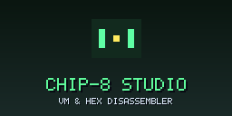
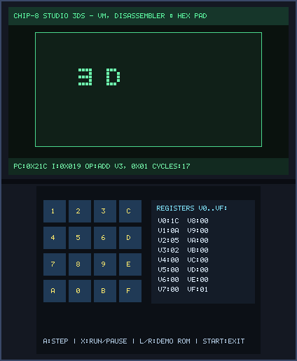
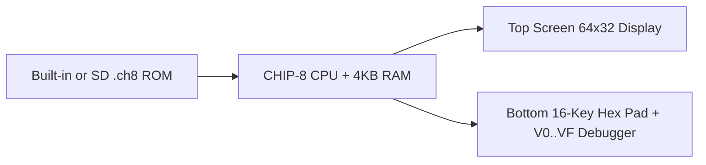

# CHIP-8 Studio (`3ds_chip8`)

<p align="center">
  
  &nbsp;&nbsp;&nbsp;
  
</p>

<p align="center">
  
</p>

> **VM & Hex Disassembler (`CTR-P-CHP8`, UniqueId `0x0D3EA`)** — Part of the [**lafiabrew**](https://github.com/orgs/lafiabrew/repositories) Nintendo 3DS Homebrew Suite.

35-opcode CHIP-8 virtual machine, live instruction disassembler, `V0..VF` register inspector, and 16-key touch hex keypad.

---

## Architecture & Data Flow



---

## Controls & Touch Ergonomics

| Button / Input | Action |
|---|---|
| `A` | Single-step one CHIP-8 instruction |
| `X` | Toggle continuous execution vs single-step debugger |
| `L` / `R` | Cycle built-in demo ROMs |
| `Bottom Touch Keypad` | 16-key hexadecimal keypad (`0..F`) + live `V0..VF` register view |

---

## Build, Verify & Install

```bash
make test
make 3ds && make verify-3ds
make qr
```
